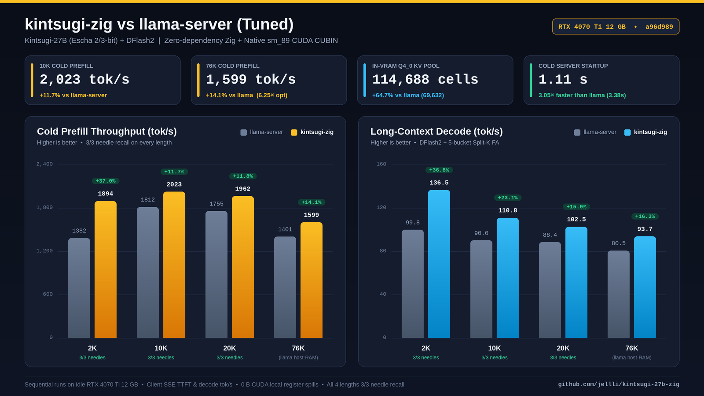
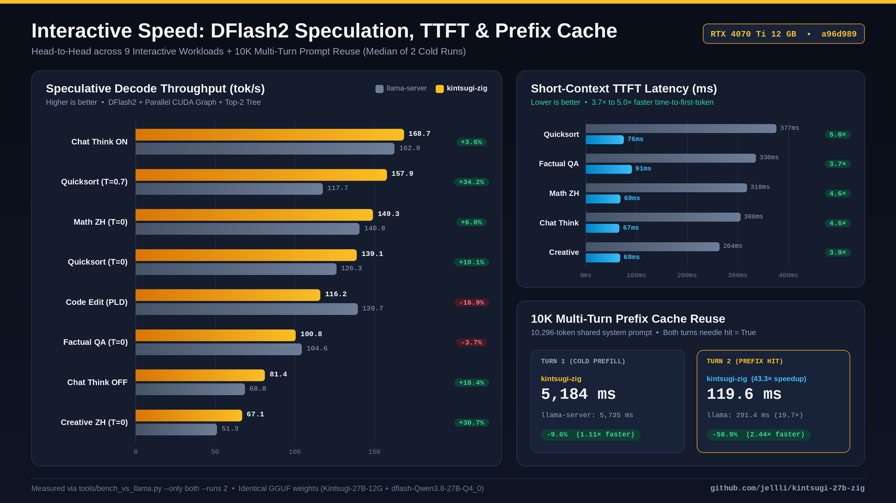
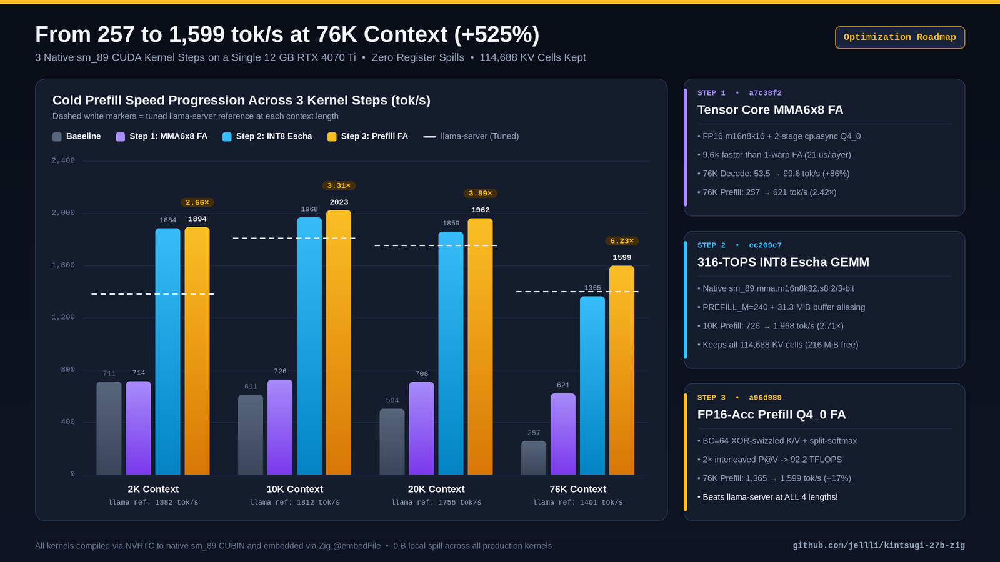

# kintsugi-zig

Dedicated bare-metal **Zig `0.17.1` + native `sm_89` CUDA** inference runtime for **Kintsugi-27B** (`Qwen3.8-27B` Escha ~2.5-bit + `DFlash2` 5-layer speculative drafter), engineered specifically for a single **NVIDIA RTX 4070 Ti (12 GB, Ada Lovelace, 60 SMs, 48 MiB L2)**.

Zero `ggml`, zero `libcudart`, zero `libstdc++`, zero external HTTP dependencies — compiles into a single self-contained native binary embedding all 6 `sm_89` CUBIN modules via `@embedFile` (`libcuda.so.1` only).



---

## Verified Head-to-Head Results vs `llama-server` (Tuned `best-v2`)

Measured sequentially on an idle **RTX 4070 Ti 12 GB** (`driver 620.70.06`) with identical weights (`Kintsugi-27B-12G.gguf` + `dflash-Qwen3.8-27B-Q4_0.gguf`) via [`tools/bench_vs_llama.py`](tools/bench_vs_llama.py) (`--only both --runs 2 --ctx-lengths 2048,10240,20480,76000`). Client-side SSE TTFT and `(completion_tokens - 1) / (t_end - t_first)` decode throughput, median of 2 cold runs.

- **`llama-server` Config**: Tuned `best-v2` (`LLAMA_HEAD2=64`, `--kv-vram-cells 69632`, `--cache-ram 6144`, `-fa on`, `-ctk/-ctv q4_0`, `--spec-type draft-dflash --spec-draft-n-max 7`)
- **`kintsugi-zig` Config**: Native `sm_89` CUBIN (`MMA6x8` + `92-TFLOPS` FP16-acc Prefill Q4_0 FA, `316-TOPS` INT8 Escha Prefill GEMM, `PREFILL_M=240`, 5-bucket Split-K, Parallel CUDA Graph DAG, Adaptive PLD + Top-2 Tree Spec, 8 Host Prefix Checkpoints)

### 1. Startup, VRAM & Capacity

| Metric | `llama-server` (Tuned) | `kintsugi-zig` | Delta (`zig` vs `llama`) |
| :--- | ---: | ---: | ---: |
| **Cold Startup** (`spawn → /health 200`) | `3.38 s` | **`1.11 s`** | **-67.2% (3.05× faster)** |
| **In-VRAM Q4_0 KV Cache Pool** | `69,632 cells` | **`114,688 cells`** | **+64.7% context** |
| **Peak Process VRAM** (full 76K suite) | `11,516 MiB` | `11,540 MiB` | `+0.2%` (`216 MiB` idle free) |
| **Pure `M=1` Decode** (No-Spec Baseline) | `36.61 tok/s` | `35.09 tok/s` | `-4.2%` |
| **Verification & Register Spills** | Baseline | **100% Pass / 0 B spill** | `40/40` tests, `15/15` ops, `32/32` spec |

### 2. Long-Context Cold Prefill, Decode & 3-Needle Recall (`/v1/chat/completions`)

| Context | Prompt Tok | `llama` Prefill | `zig` Prefill | Prefill Delta | `llama` Decode | `zig` Decode | Decode Delta | Needles (L / Z) |
| :--- | ---: | ---: | ---: | ---: | ---: | ---: | ---: | :---: |
| **2K** | 2,145 | 1,382.4 tok/s (`1.55s`) | **1,893.5 tok/s** (`1.13s`) | **+37.0%** | 99.75 tok/s | **136.46 tok/s** | **+36.8%** | 3/3 / **3/3** |
| **10K** | 10,289 | 1,811.5 tok/s (`5.68s`) | **2,023.4 tok/s** (`5.09s`) | **+11.7%** | 90.00 tok/s | **110.81 tok/s** | **+23.1%** | 3/3 / **3/3** |
| **20K** | 20,563 | 1,755.1 tok/s (`11.72s`) | **1,961.5 tok/s** (`10.48s`) | **+11.8%** | 88.40 tok/s | **102.45 tok/s** | **+15.9%** | 3/3 / **3/3** |
| **76K** *(llama host-RAM)* | 75,968 | 1,401.3 tok/s (`54.21s`) | **1,599.2 tok/s** (`47.50s`) | **+14.1%** | 80.55 tok/s | **93.70 tok/s** | **+16.3%** | 3/3 / **3/3** |

### 3. Multi-Turn ~10K Prefix Cache Reuse (`10,296` Shared Prompt Tokens)

| Metric | `llama-server` (`--cache-ram 6144`) | `kintsugi-zig` (8 Host Checkpoints) | Delta |
| :--- | ---: | ---: | ---: |
| **Turn 1 Cold TTFT** | `5,734.7 ms` | **`5,184.1 ms`** | **-9.6% (1.11× faster)** |
| **Turn 2 Cached TTFT** | `291.4 ms` (`19.7×`) | **`119.6 ms`** (**`43.3×`**) | **-58.9% (2.44× faster)** |
| **Needle Recall (T1 / T2)** | `True / True` | **`True / True`** | Exact |

### 4. Short-Context Speculative Decode & Chat API (`max_tokens=256`)

| Workload | `llama` Decode | `zig` Decode | Decode Delta | `llama` TTFT | `zig` TTFT | TTFT Delta |
| :--- | ---: | ---: | ---: | ---: | ---: | ---: |
| **Quicksort** (EN Code, T=0) | 126.31 tok/s | **139.07 tok/s** | **+10.1%** | 376.8 ms | **75.6 ms** | **-79.9% (4.98×)** |
| **Code Refactor** (PLD, T=0, 40 tok) | 139.71 tok/s | 116.16 tok/s | -16.9% | 547.7 ms | **200.6 ms** | **-63.4% (2.73×)** |
| **Factual QA** (EN, T=0) | 104.61 tok/s | 100.76 tok/s | -3.7% | 336.4 ms | **91.3 ms** | **-72.9% (3.69×)** |
| **Math Reasoning** (ZH, T=0) | 140.79 tok/s | **149.28 tok/s** | **+6.0%** | 318.5 ms | **68.9 ms** | **-78.4% (4.62×)** |
| **Creative Prose** (ZH Floor, T=0) | 51.33 tok/s | **67.08 tok/s** | **+30.7%** | 264.5 ms | **68.2 ms** | **-74.2% (3.88×)** |
| **Quicksort** (EN, T=0.7) | 117.71 tok/s | **157.94 tok/s** | **+34.2%** | 246.9 ms | **52.8 ms** | **-78.6% (4.68×)** |
| **Creative Prose** (ZH, T=0.7) | 51.23 tok/s | **54.92 tok/s** | **+7.2%** | 268.5 ms | **68.3 ms** | **-74.6% (3.93×)** |
| **Chat Thinking OFF** (ZH Direct) | 68.77 tok/s | **81.42 tok/s** | **+18.4%** | 258.0 ms | **67.6 ms** | **-73.8% (3.82×)** |
| **Chat Thinking ON** (`17*29+143=636`) | 162.84 tok/s | **168.67 tok/s** | **+3.6%** | 305.7 ms | **66.8 ms** | **-78.2% (4.58×)** |



### 5. Three-Step Native `sm_89` Optimization Journey



- **Step 1 (`4cbc35a`) — `MMA6x8` `cp.async` Q4_0 FlashAttention**: 9.65× faster than 1-warp FA (`21.2 us/layer` at 2K), pushing 76K decode `+86%` (`53.5 → 99.6 tok/s`) and 76K prefill `2.42×` (`256.8 → 621.4 tok/s`).
- **Step 2 (`556417a`) — 316-TOPS INT8 Tensor Core Escha Prefill GEMM + `PREFILL_M=240`**: Native `mma.sync.aligned.m16n8k32.row.col.s32.s8.s8.s32` + `31.3 MiB` non-overlapping scratchpad aliasing (preserving all `114,688` KV cells), jumping 10K prefill `2.71×` (`725.5 → 1,967.9 tok/s`).
- **Step 3 (`edc151c`) — 92-TFLOPS FP16-Acc Prefill Q4_0 FlashAttention**: `BC=64`, XOR-swizzled K/V-aliased `sh_kv`, `LOG2E` folded into `Q`, split online softmax across D-halves, and 2× `dp`-interleaved `P@V` into FP32 `O` (`168 regs`, `0 B` spill), pushing 76K prefill to **`1,599.2 tok/s`** (**`6.25×`** baseline, **`+14.1%`** vs `llama-server`).

### Per-Step Speculative Latency Breakdown (`35.04 ms/step`, `bench-spec`)
- **Target 64L Trunk (`M=8`, CUDA Graph)**: `27.29 ms`
- **Target 2-Stage LM Head (`248,320` vocab)**: `2.09 ms` (GPU `Q4_0 × Q8_1` LDG.128 + Bitonic Top-64: `1.87 ms` | CPU `Q8_0` exact rescore from host mmap: `0.22 ms`, zero VRAM)
- **Fused Parallel Commit + Inject + DFlash2 Draft (CUDA Graph DAG)**: `5.66 ms` (vs `5.99 ms` sequential: GDN commit `0.89 ms` + KV ring inject `0.32 ms` + DFlash2 5L trunk/selector `2.92 ms` + LM head `M=7` `1.86 ms`)

---

## Architecture
- **Host runtime (`src/`)**: Pure Zig `0.17.1` calling `libcuda.so.1` directly via the CUDA Driver API (`src/cuda.zig`), zero-copy `mmap` GGUF v3 loader (`src/gguf.zig`), Qwen3.5 byte-level BPE tokenizer (`src/tokenizer.zig`), 64-layer hybrid GDN/FullAttn engine (`src/engine.zig`), DFlash2 5-layer speculative drafter with Adaptive PLD + Top-2 Tree verification (`src/dflash.zig`), and zero-dependency OpenAI HTTP/1.1 + SSE server with 8-slot host prefix checkpoint cache (`src/server.zig`).
- **Native `sm_89` kernels (`kernels/`)**: Compiled directly to `sm_89` CUBINs via CUDA 12.8 NVRTC (`tools/compile_cubin.py`), **0 bytes local register spill** across all production kernels:
  - `kernels/sm89_core.cu`: Fused residual + bias + RMSNorm + 2×/3× 128-pt Hadamard (`FP16`), DFlash2 hidden-state capture, GPU `Q8_0 → Q4_0` LM-head transcoder.
  - `kernels/escha_sm89.cu`: 2-bit & 3-bit Escha MCG Trellis `m16n8k16` GEMV (`narrow16` decode) + **316-TOPS INT8 Tensor Core `m16n8k32` prefill GEMM** (`m128n64` / `m256n64`) with per-token FP16→INT8 quantization.
  - `kernels/gdn_sm89.cu`: 48-layer Gated DeltaNet Conv1D+SiLU+L2Norm, α/β gates, register-resident FP32 recurrence with speculative & Top-2 tree verify/commit snapshot, fused RMSNorm×SiLU(z)+Had128.
  - `kernels/attn_sm89.cu`: 16-layer Full Attention Q/K RMSNorm + MRoPE (`freq_base=1e7`) + Q4_0 KV append, **`MMA6x8` `cp.async` Tensor Core Split-K FlashAttention** (decode/verify/tree), **`92-TFLOPS` FP16-acc `BC=64` Prefill Q4_0 FlashAttention** (`94,592 B` opt-in dynamic smem), device-pointer `_dpos` wrappers for static CUDA Graph capture.
  - `kernels/lmhead_sm89.cu`: Fused SwiGLU+Had128, vectorized LDG.128 shared-memory `Q4_0 × Q8_1` `__dp4a` GEMV (`M=1,7,8`), parallel-bitonic exact GPU Top-64.
  - `kernels/dflash_sm89.cu`: DFlash2 5-layer RMSNorm, dynamic grouped causal Conv2, QK-Norm + NeoX RoPE(128), FP16 SWA-2048 ring buffer KV inject, non-causal GQA (32:8) FlashAttention, fused SwiGLU→Q8_1.
- **Zero-VRAM Host-Mmap Offload + Scratchpad Aliasing**: `token_embd.weight` (`1.26 GiB`), `output.weight` Q8_0 Stage-2 rescore (`1.26 GiB`), and DFlash2 selectors (`68.2 MiB`) stay out of VRAM via zero-copy `mmap`, plus `31.3 MiB` non-overlapping prefill buffer aliasing — keeping **`114,688` in-VRAM Q4_0 KV cells** (`+64.7%` vs `llama-server`) inside 12 GB VRAM.
- **Parallel CUDA Graph Capture**: 5-bucket Split-K target `M=8` verify (linear & Top-2 tree), plus parallel-stream `commit + inject + draft` CUDA Graph DAGs all replay from cached `CUgraphExec` handles with device-side `pos` indirection.

---

## Build & Run

```bash
export PATH="$HOME/.local/toolchains/zig-0.17.1:$PATH"

# Build & run unit tests (no GPU required for tests)
zig build -Doptimize=ReleaseFast
zig build test

# Hardware probe, GGUF VRAM plan & kernel benchmarks
./zig-out/bin/kintsugi-zig probe
./zig-out/bin/kintsugi-zig info
./zig-out/bin/kintsugi-zig bench-escha
./zig-out/bin/kintsugi-zig bench-ops

# End-to-end verification & speculative decoding benchmark
./zig-out/bin/kintsugi-zig verify-e2e
./zig-out/bin/kintsugi-zig bench-spec

# Full head-to-head benchmark vs llama-server (2K..76K + 3-needle recall + 10K prefix cache)
python3 tools/bench_vs_llama.py --only both --runs 2 --ctx-lengths 2048,10240,20480,76000

# CLI text generation (DFlash2 speculative decoding on by default; pass --no-spec for M=1)
./zig-out/bin/kintsugi-zig generate --prompt "The capital of France is" --max-tokens 64 --temp 0.0

# OpenAI-compatible HTTP/1.1 + SSE streaming server
./zig-out/bin/kintsugi-zig serve --host 0.0.0.0 --port 8080
```

### HTTP Server Endpoints
- `GET  /health` — liveness, speculative flag, allocated VRAM KV cells
- `GET  /v1/models` — OpenAI models list (`Kintsugi-27B`)
- `POST /tokenize` — `{"content": "..."}` → `{"tokens": [...]}`
- `POST /v1/completions` — OpenAI completions (`prompt`, `max_tokens`, `temperature`, `top_k`, `top_p`, `seed`, `stop`, `stream: true|false`, plus `timings`)
- `POST /v1/chat/completions` — OpenAI chat completions with Qwen3.5 ChatML formatting, UTF-8-safe SSE streaming, and optional `"enable_thinking": false`
